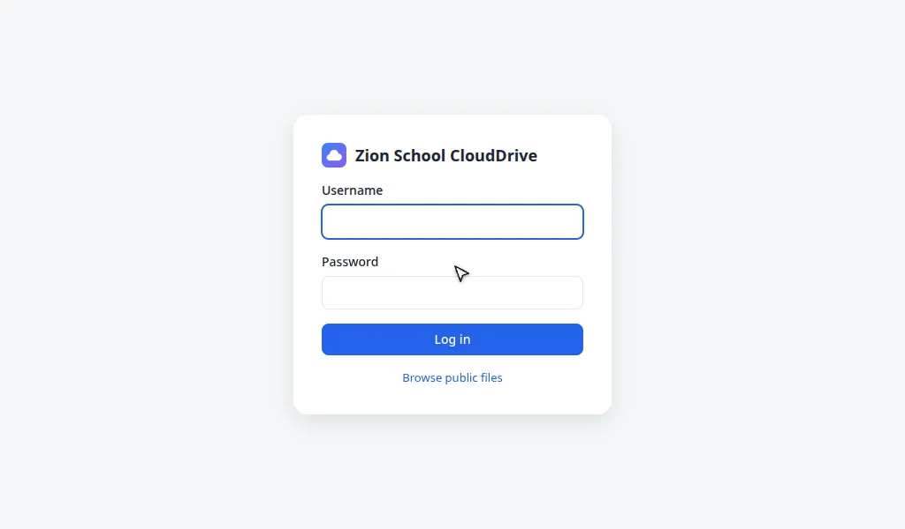

# CloudDrive
PHP based file storage website like a small Google Drive. 

To make site management easier, it uses **no database**. Users, quotas, shares and settings are stored in CSV files, and every user's files and folders are under `data/<username>/`.



## Features

- No database required, all data is stored in files and folders.
- Familiar file manager interface.
- Add users by modifying `users.csv`, and set storage quotas in `quotas.csv`.
- Share files and folders with other users.
- Upload files and folders with drag & drop support.
- Download folder or several items at once as a ZIP.
- Thumbnail support for pictures, videos and other files (through plugin support).
- Keyboard shortcuts: `Ctrl+A`, `Ctrl+C`, `Ctrl+X`, `Ctrl+V`, `Delete`, `Shift+Delete`, `Esc`.
- Site is optimized for use with phones and tablets.


## Installation
- Install [XAMPP](https://www.apachefriends.org/index.html) or any other web server with PHP 8.1 or newer.
  - PHP extensions used: `gd`, `zip`, `mbstring`, `xml`, `exif` (most are enabled by default).
  - Optional: [7-Zip](https://www.7-zip.org/) (`7zz` or `7z` on the PATH; Debian/Ubuntu package `7zip`) to open RAR and 7z archives.
- Download [as ZIP](https://github.com/zion-school/CloudDrive/archive/refs/heads/main.zip) or clone the repository
- Place the files in C:\xampp\htdocs\CloudDrive or the web server's root directory (Linux: `/var/www/html/CloudDrive`)
- Make sure the web server can write to the `data/` and `temp/` folders (they are created if missing).

## Supported File Formats

Images, video, audio, PDF and text are handled by the app itself, the rest by the [built-in plugins](plugins).

| Format | Extensions | View | Edit | Thumbnail |
|---|---|:-:|:-:|:-:|
| Images | jpg, jpeg, png, gif, bmp, webp | ✅ | | ✅ |
| Video | mp4, webm, mov, mkv | ✅ | | ✅¹ |
| Audio | mp3, wav, ogg, oga, opus, m4a, flac, aac | ✅ | | ✅² |
| PDF | pdf | ✅ | | |
| Text, code | txt, md, log, json, xml, yaml, css, js, py, c, cpp, java, php, sql… | ✅ | ✅ | text |
| Web page | html, htm (sandboxed, no scripts) | ✅ | ✅ | text |
| CSV, rich text | csv, tsv, rtf | ✅ | ✅ | text |
| Word, Excel | docx, docm, doc, xlsx, xlsm, xls | ✅³ | | ✅⁴ |
| OpenDocument | odt, ods, odp | ✅³ | | ✅ |
| Archives | zip, rar⁵, 7z⁵, tar, tgz, gz | ✅⁶ | | text |
| 3D, G-code | stl, 3mf, obj, glb, gcode, gco | ✅ | | ✅ |

¹ cover art, or a frame with `ffmpeg` · ² cover art · ³ simplified (doc: text only, xls / xlsx: values only) ·
⁴ if saved with one, else text · ⁵ needs [7-Zip](https://www.7-zip.org/) · ⁶ open the files inside, password-protected too ·
*text* = the first lines of the file

Editing is for your own files (shared files and files inside archives are read-only). Other files can be stored, shared and downloaded, but have no preview.

See [plugins/README.md](plugins/README.md). Ask an AI coding assistant to create a plugin for a specific file type if you need one.

## Customization
- Edit the `config.php` file for customization
  - `SITE_TITLE` - Name shown in the browser tab and next to the logo
  - `USERS_FILE` - Path to the CSV file containing user information (default `users.csv`)
    Format of the CSV file:
    ```
    name,username,password,email,class,date_of_birth
    BOZ,admin,0000,admin@zionschool.com,-,02-Jun-2000
    Winston,winston,1234,winston@zionschool.com,-,-
    Stephen,stephen,1234,,,
    Bob,bob,5678,bob@zionschool.com,4,15-Aug-2017
    ```
  - `QUOTAS_FILE` - Path to the CSV file with storage quotas (default `quotas.csv`)
    Format of the CSV file (`-1` = unlimited, sizes like `500M` or `2G`):
    ```
    username, quota
    admin, -1
    winston, 500M
    bob, 200M
    ```
  - `DEFAULT_QUOTA` - Quota for users not listed in `quotas.csv` (default 100 MB)
  - `MAX_UPLOAD_SIZE` - Largest file that can be uploaded (default 1 GB)
  - `DATA_DIR` / `TEMP_DIR` - Where user files and temporary files are kept
  - `SEVENZIP` - Path to the 7-Zip program, `''` to find it automatically, or `'off'`

⚠️ Keep `.htaccess` in place (Apache): it blocks direct web access to `data/`, `temp/` and the CSV files.

## License

MIT
